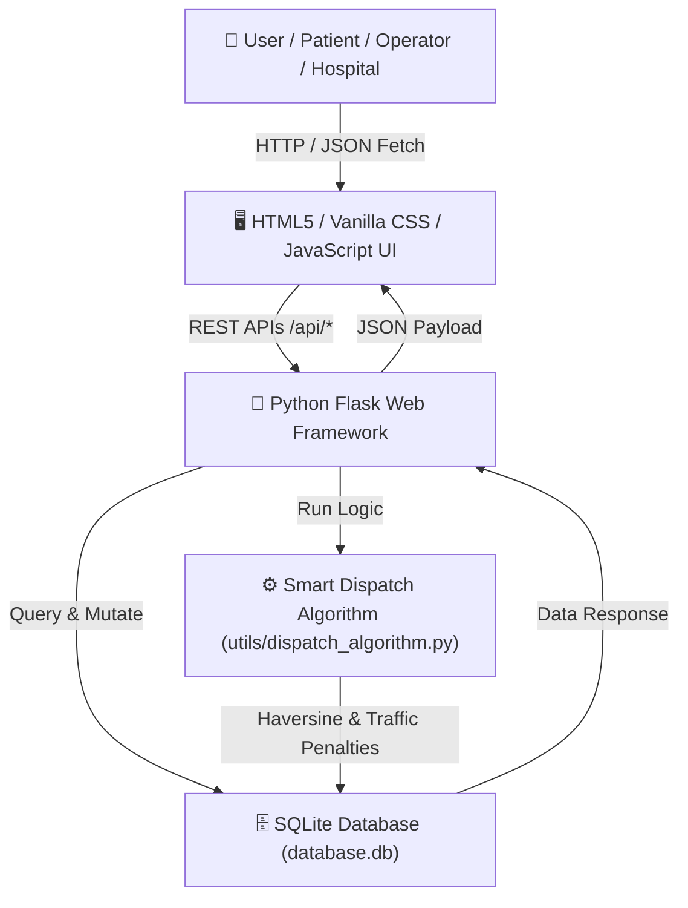

# Smart Ambulance Dispatch System 🚑

A smart ambulance dispatch system using Python, Flask, SQLite, and intelligent routing algorithms to manage emergency requests, ambulance allocation, hospital selection, and tracking.

The system uses Python, Flask, and SQLite on the backend combined with a responsive, modern HTML/CSS/JavaScript frontend to perform real-time optimal ambulance allocation, traffic-aware travel time (ETA) calculations, and hospital care capacity matching.

---

## 🌟 Key Features

1. **Smart Ambulance Dispatch Engine (`dispatch_algorithm.py`)**:
   - Calculates **Haversine great-circle distances** between candidate ambulances and patient pickup locations.
   - Evaluates SQLite-stored **traffic bottlenecks** (e.g., Bharat Nagar Chowk, GT Road Flyover) and applies travel time delay penalties and alternative route suggestions.
   - Computes composite dispatch ranking scores based on:
     $$\text{Dispatch Score} = \text{Distance Factor} + \text{Traffic Factor} + \text{Availability Factor} + \text{Equipment Factor}$$
   - Automatically selects the optimal ambulance and provides alternative fleet options.

2. **Nearest Suitable Hospital Recommendation**:
   - Evaluates hospital proximity, bed availability, and specialty department readiness (ICU, Cardiology, Trauma Care).
   - Automatically creates instant notifications in SQLite for the receiving hospital's reception dashboard upon dispatch.

3. **Role-Based Portals & Dashboards**:
   - **Patient Portal**: Submit emergency bookings, view priority assessment scores, track assigned ambulance details, driver contact, and arrival ETAs.
   - **Hospital Staff Dashboard**: Monitor incoming emergency cases, acknowledge alerts, edit available bed counts in real time, and toggle department emergency availability.
   - **Admin / Control Room Dashboard**: Complete fleet overview, active emergency queue, live response map visualizer, full CRUD for fleet/hospitals/traffic areas, and booking lifecycle status management (`ASSIGNED` &rarr; `ON THE WAY` &rarr; `ARRIVED` &rarr; `COMPLETED`).

4. **Ambulance Tracking & Development Simulation**:
   - Provides live location updates via `/api/booking/<id>/tracking`.
   - Includes a **Development GPS Simulation Mode** to simulate step-by-step vehicle movement towards the destination.

5. **Security & Authentication**:
   - Role-based authorization (`patient`, `hospital`, `operator`).
   - Secure password hashing powered by `werkzeug.security`.
   - Flask session management and parameterized SQL queries.

---

## 🏗️ System Architecture



---

## 📂 Project Directory Structure

```
Smart Ambulance Dispatch System Project/
├── app.py                      # Flask main server application & error handlers
├── requirements.txt            # Python dependencies (Flask, werkzeug, etc.)
├── smart_ambulance_dispatch_dataset (1).csv # Project dataset
├── hero-illustration.jpg       # Project illustration
├── test_system.py              # Automated test suite (UnitTest)
├── README.md                   # Project documentation
├── models/
│   └── database.py             # SQLite table schemas, init_db(), seed_db() & migrations
├── routes/
│   └── api_routes.py          # Flask REST API blueprint endpoints
├── utils/
│   └── dispatch_algorithm.py   # Haversine distance, traffic penalty & dispatch score logic
├── templates/
│   └── index.html              # Main responsive web application template
└── static/
    ├── css/
    │   └── styles.css          # Vanilla CSS design system & responsive layout styles
    ├── images/
    │   └── hero-illustration.jpg
    └── js/
        └── script.js           # Frontend client logic, API calls & dynamic rendering
```

The SQLite database is generated locally by the application and is intentionally not tracked because it can contain personal or operational data.

---

## 📊 Database Schema (`models/database.py`)

- `users`: `id`, `name`, `email`, `phone`, `password` (hashed), `role`, `created_at`
- `patients`: `id`, `user_id`, `name`, `age`, `gender`, `blood_group`, `medical_condition`, `emergency_contact`
- `ambulances`: `id`, `ambulance_number`, `driver_name`, `driver_phone`, `latitude`, `longitude`, `status`, `current_location`, `ambulance_type`, `equipment`, `created_at`
- `hospitals`: `id`, `name`, `address`, `latitude`, `longitude`, `emergency_available`, `available_beds`, `total_beds`, `status`, `icu_available`, `cardiology_available`, `trauma_available`
- `bookings`: `id`, `booking_code`, `patient_id`, `ambulance_id`, `hospital_id`, `caller_name`, `pickup_location`, `pickup_lat`, `pickup_lon`, `destination`, `emergency_type`, `priority`, `priority_score`, `booking_status`, `description`, `created_at`, `assigned_at`, `completed_at`
- `traffic_areas`: `id`, `area_name`, `latitude`, `longitude`, `severity`, `delay_minutes`, `alternative_route`
- `notifications`: `id`, `booking_id`, `hospital_id`, `message`, `notification_type`, `status`, `created_at`
- `ambulance_tracking`: `id`, `ambulance_id`, `booking_id`, `latitude`, `longitude`, `status`, `timestamp`

---

## 🔑 Demo Access Credentials

The database is automatically seeded upon first launch with test accounts:

| Role | Email | Password | Access Level |
|---|---|---|---|
| **Dispatch Operator / Admin** | `operator@smartdispatch.org` | `admin123` | Full Control Room Dashboard & Management |
| **Hospital Staff** | `citycare@hospital.org` | `hospital123` | Incoming Alerts & Bed Management |
| **Patient / Citizen** | `priya@gmail.com` | `patient123` | Emergency Intake & Booking Tracking |

---

## 🛠️ How to Run & Test

### 1. Run the Flask Web Application
```bash
python app.py
```
Open your browser and navigate to: [http://localhost:5050](http://localhost:5050)

### 2. Run Automated Test Suite
```bash
python test_system.py
```

---

## 🔌 API Endpoints Summary

- `POST /api/register` - Register a new user (`patient`, `hospital`, `operator`).
- `POST /api/login` - Authenticate user & open session.
- `POST /api/logout` - Clear user session.
- `GET /api/current_user` - Check active session.
- `POST /api/book-ambulance` - Submit emergency intake & execute smart dispatch.
- `GET /api/bookings` - Fetch all bookings.
- `GET /api/bookings/<id>` - Fetch single booking details.
- `PUT /api/bookings/<id>/status` - Update booking lifecycle (`ASSIGNED` &rarr; `ON_THE_WAY` &rarr; `ARRIVED` &rarr; `COMPLETED`). Completing a booking automatically releases the assigned ambulance back to `AVAILABLE`.
- `GET /api/ambulances` - Fetch ambulance fleet.
- `POST /api/ambulances` - Add a new ambulance.
- `PUT /api/ambulances/<id>` - Edit ambulance details.
- `POST /api/ambulances/<id>/simulate-movement` - Simulate GPS step movement.
- `GET /api/booking/<id>/tracking` - Fetch live tracking data & remaining ETA.
- `GET /api/hospitals` - Fetch hospitals & bed capacity.
- `POST /api/hospitals` - Add new hospital.
- `PUT /api/hospitals/<id>` - Update hospital beds or department status.
- `GET /api/notifications` - Fetch hospital dispatch alerts.
- `POST /api/notifications/<id>/acknowledge` - Acknowledge alert.
- `GET /api/traffic-areas` - Fetch traffic bottlenecks.
- `GET /api/dashboard/stats` - Fetch real-time dashboard metrics.
